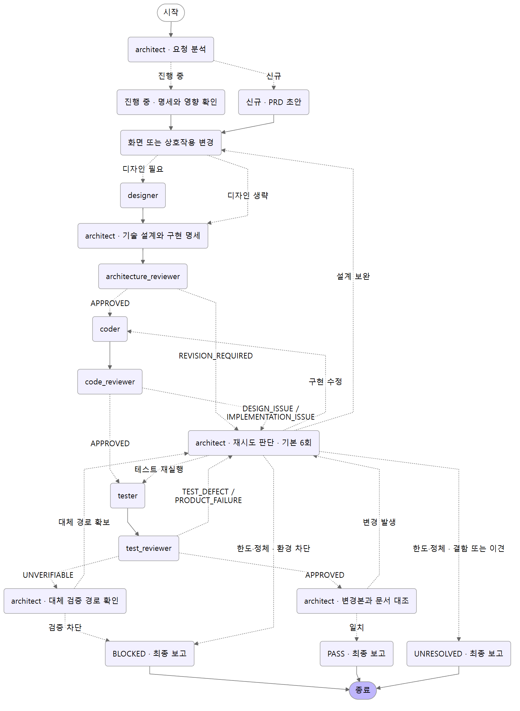

# french-toast · AX Architecture

문서 유형 · 저장소 안내\
상태 · AX 운영 지침\
갱신일 · 2026-11-11\
관련 요구사항과 문서 · [저장소 지침](AGENTS.md), [개발 워크플로](.agent/workflows/development.md), [PRD](docs/prd/product.md)

## 만들게 된 배경

코딩 에이전트를 많이 쓰면서 AI가 무엇을 잘하고 어디에서 흔들리는지 피부로 느꼈다. 짧은 요청만으로 막혀 있던 구현이 풀릴 때도 있었고, 비슷한 작업인데도 모델과 내가 건넨 맥락에 따라 결과의 질이 달라질 때도 있었다. 대화가 길어지면 이미 합의한 요구사항이나 작은 예외를 다시 알려줘야 했다. 첫 답이 빨라도 이후에 쓴 토큰과 기다린 시간, 내가 코드를 읽고 다시 고친 시간까지 합치면 체감 비용은 달랐다. 그 경험을 바탕으로 내가 쓰고 싶은 코딩 에이전트 워크플로, French Toast를 직접 만들었다.

프렌치토스트를 만들 때는 계란과 우유를 섞어 빵을 담근다. 너무 빨리 건지면 겉만 젖고 속까지 스며들지 않는다. 너무 오래 담그면 빵이 찢어지거나 눅눅해진다. 굽는 시간도 중요하다. 너무 짧게 구우면 속이 덜 익고, 너무 오래 구우면 타거나 촉촉함을 잃는다. 빵의 두께와 계란물이 스며든 정도에 맞춰 언제 건질지, 얼마나 구울지 함께 정해야 한다.

코딩 에이전트도 한 세션에서 일을 얼마나 이어갈지, 언제 다음 역할로 넘길지 판단해야 한다. 같은 에이전트를 유지하면 앞에서 내린 결정과 코드를 살피며 얻은 정보를 이어 쓸 수 있다. 작업이 길어지면 쌓인 맥락을 처리하는 데 시간과 토큰이 들고, 중요한 제약을 놓치면 같은 일을 다시 하게 된다. 이게 **지속 비용**이다. 다른 에이전트에게 넘기면 전문 작업에 집중하거나 독립적인 시선으로 결과를 살필 수 있다. 그때마다 요구사항과 결정의 배경을 넘겨야 하고, 다음 에이전트는 코드를 다시 읽어 맥락을 파악해야 한다. 인수인계 과정에서 세부 정보가 빠지기도 한다. 이게 **전환 비용**이다.

French Toast를 만들며 계속 던진 질문은 ‘어디서 역할을 나눠야 작업 전체가 더 효율적일까?’였다. 내가 생각하는 효율은 토큰과 대기 시간, 인수인계와 재작업까지 포함해 **검증된 변경을 끝낼 때까지 드는 총비용**을 줄이는 것이다.

## 핵심 원리

1. **이어 쓸 맥락은 유지하고, 전문성이나 독립 판단이 필요한 지점에서 역할을 전환한다.** `architect`가 결정과 진행 상황을 이어가고, `coder` 한 명이 프런트엔드와 백엔드를 포함한 구현 전체를 맡는다. UI 설계나 독립 검토를 맡길 때는 다음 에이전트에게 필요한 문서, 요구사항 ID와 변경분을 전달한다.
2. **제품 요구사항에서 검증까지 같은 ID로 추적한다.** `architect`가 제품 범위와 기술 설계를 함께 책임진다. PRD의 요구사항 ID를 설계, 구현 명세, 테스트 증거에 기록해 수용 기준마다 대응하는 구현과 실행 결과를 찾을 수 있게 한다.
3. **설계·구현·테스트를 독립적으로 검토한다.** 단계마다 작성자와 다른 스레드의 리뷰어가 결과를 확인한다. 테스트는 수용 기준에서 기대값을 정하고, 잘못된 동작이 실제로 실패로 잡히는지 검토한다.
4. **한 번의 요청으로 수정과 재검증을 이어간다.** 결함 유형에 따라 설계, 구현, 테스트 단계 중 필요한 곳으로 돌아간다. 테스트한 변경본과 검토한 변경본이 일치해야 승인을 기록한다. 막힌 경로와 재시도 한도도 보고한다.

## 워크플로



단계별 호출과 재시도는 [전환표](.agent/workflows/development.md)를 따른다. 개발 작업은 로컬 Codex와 프로젝트 지침으로 실행한다. 그림은 같은 흐름을 LangGraph `StateGraph`로 표현한 문서 산출물이다.

## 디렉토리

| 경로 | 내용 |
| --- | --- |
| [`AGENTS.md`](AGENTS.md) | 로컬 Codex가 읽는 루트 지침과 역할 호출 조건 |
| [`.agent/`](.agent/) | 메인 역할, 공통 규칙, 전환표와 그림 생성 도구 |
| [`.codex/agents/`](.codex/agents/) | 여섯 서브에이전트 TOML과 기존 역할 초안. 활성 역할의 링크는 `AGENTS.md`에 있다. |
| [`.agents/skills/`](.agents/skills/) | 실제 실행 경로를 추적하는 스킬과 테스트 증거를 만드는 스킬 |
| [`docs/`](docs/) | PRD, API 계약, ADR, 디자인, 구현 명세, 실행 기록과 그림. `Example` 문서는 EX-BMK-001을 사용한 작성 예시다. |

## 로컬 Codex에서 사용

저장소 루트를 Codex 앱에서 열거나 루트에서 Codex CLI를 시작한다. 저장소를 신뢰하는 세션에서 다음처럼 요청한다.

> AX 개발 워크플로를 실행해. [바꿀 기능과 수용 기준]. 정의된 서브에이전트를 호출해서 검증과 최종 보고까지 진행해.

## 그림 재생성

Python 3.11 이상과 Mermaid CLI를 사용한다. Python 가상 환경과 Mermaid CLI를 그림 생성용으로 준비한다. Mermaid CLI는 사용할 Chrome 또는 Chromium이 필요하다. CLI에 브라우저가 설치되어 있지 않으면 `--puppeteer-config <파일>`로 `executablePath`가 담긴 JSON을 전달할 수 있다.

```powershell
$axTools = Join-Path $env:TEMP 'french-toast-ax'
python -m venv (Join-Path $axTools 'venv')
$axPython = Join-Path $axTools 'venv/Scripts/python.exe'
& $axPython -m pip install langgraph==1.2.20
npm install --prefix $axTools @mermaid-js/mermaid-cli@11.12.0
$axMermaid = Join-Path $axTools 'node_modules/.bin/mmdc.cmd'
& $axPython .agent/tools/render_workflow.py --mermaid-cli $axMermaid
```

스크립트는 README에 표시되는 [PNG](docs/assets/ax-workflow.png)를 갱신한다. Mermaid 원본이나 SVG가 필요하면 `--output ax-workflow.mmd` 또는 `--output ax-workflow.svg`를 추가한다.

## pstack에서 참고한 작업 방식

- 설계와 구현에 앞서 호출자 관점에서 기존 실행 경로와 공개 계약을 확인한다. [how](https://github.com/cursor/plugins/blob/main/pstack/skills/how/SKILL.md), [architect](https://github.com/cursor/plugins/blob/main/pstack/skills/architect/SKILL.md)
- 리뷰 지적은 사용자 의도와 실제 변경을 대조하고, 재현 조건과 근거로 판단한다. 결함 수정의 회귀 검증은 가능하면 수정 전 실패와 수정 후 성공을 같은 절차로 확인한다. [interrogate](https://github.com/cursor/plugins/blob/main/pstack/skills/interrogate/SKILL.md), [tdd](https://github.com/cursor/plugins/blob/main/pstack/skills/tdd/SKILL.md)
- 상태 전환과 실패 뒤의 복구 경로를 사용자 조작으로 표현하고, 중요한 결정과 증거의 위치를 기록한다. [statechart](https://github.com/cursor/plugins/blob/main/pstack/skills/statechart/SKILL.md), [show-me-your-work](https://github.com/cursor/plugins/blob/main/pstack/skills/show-me-your-work/SKILL.md)

## 참고 문서

- [Codex 프로젝트 지침](https://developers.openai.com/codex/guides/agents-md)
- [Codex 서브에이전트](https://developers.openai.com/codex/subagents)
- [Codex 스킬](https://developers.openai.com/codex/skills)
- [LangGraph Graph API](https://docs.langchain.com/oss/python/langgraph/graph-api)
