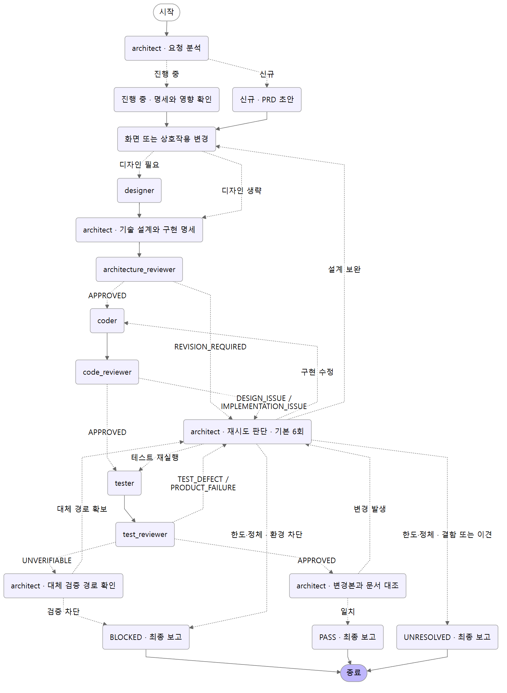

# French Toast development guide

Document type · Repository maintenance guide\
Status · Active\
Updated · 2026-11-13\
Related documents · [PRD](prd/product.md), [Repository instructions](../AGENTS.md), [Public README](../README.md)

This guide covers the repository-native workflow and its diagram. Use the public README to install the French Toast plugin into another project.

## Workflow



The LangGraph `StateGraph` diagram shows the main roles and verdicts. Local Codex and Claude Code use the shared [transition table](../.agent/workflows/development.md).

Two rules apply at every stage. Report `BLOCKED` if a required role is unavailable and there is no way to run it. If a prerequisite approval does not cover the current inputs, return to the earliest affected stage.

## Repository layout

| Path | Contents |
| --- | --- |
| [`AGENTS.md`](../AGENTS.md) | Shared repository instructions and role entry conditions |
| [`CLAUDE.md`](../CLAUDE.md) | Claude Code project instructions and AX role mapping |
| [`.agent/`](../.agent/) | The `architect` role, shared standards, transitions, and diagram renderer linked from the root instructions |
| [`.codex/agents/`](../.codex/agents/) | Six project subagent TOML files loaded by Codex |
| [`.agents/skills/`](../.agents/skills/) | Change tracing and test evidence skills discovered by Codex |
| [`.claude/agents/`](../.claude/agents/) | Six project subagent definitions loaded by Claude Code |
| [`.claude/skills/`](../.claude/skills/) | Change tracing and test evidence skills discovered by Claude Code |
| [`docs/`](./) | PRD, API contract, ADRs, designs, implementation briefs, test records, and the diagram. The examples share requirement EX-BMK-001. |

## Run with local Codex

Open the repository root in the Codex app or start the CLI there. In a session where you trust the repository, use a request such as this.

> Run the AX development workflow. [Feature to change and acceptance criteria]. Invoke the configured subagents and continue through verification and the final report.

## Run with local Claude Code

Start `claude` from the repository root. In a trusted session, use the AX workflow request above to run the same stages through the configured Claude Code subagents. Use `/agents` to check the available roles and `/memory` to check the loaded project instructions.

Run `/ax-change-trace` for change tracing or `/ax-test-evidence` for test design and evidence review. Claude can also load either skill when it matches your request.

## Regenerate the diagram

Use Python 3.11 or later and Mermaid CLI. Prepare a Python virtual environment and Mermaid CLI for rendering. Mermaid CLI needs Chrome or Chromium. If it does not have a browser installed, use `--puppeteer-config <file>` with a JSON file that sets `executablePath`.

```powershell
$axTools = Join-Path $env:TEMP 'french-toast-ax'
python -m venv (Join-Path $axTools 'venv')
$axPython = Join-Path $axTools 'venv/Scripts/python.exe'
& $axPython -m pip install langgraph==1.2.20
npm install --prefix $axTools @mermaid-js/mermaid-cli@11.12.0
$axMermaid = Join-Path $axTools 'node_modules/.bin/mmdc.cmd'
& $axPython .agent/tools/render_workflow.py --mermaid-cli $axMermaid
```

The script updates the [PNG](assets/ax-workflow.png) embedded in this README. Add `--output ax-workflow.mmd` for Mermaid source or `--output ax-workflow.svg` for an SVG.
